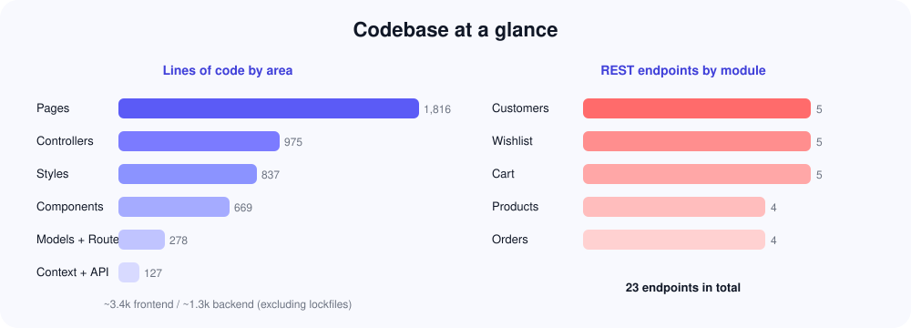
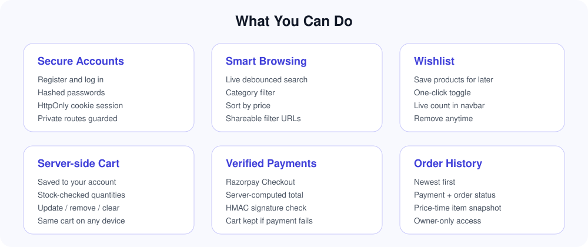
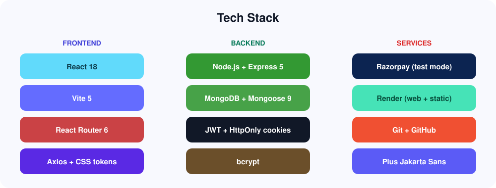
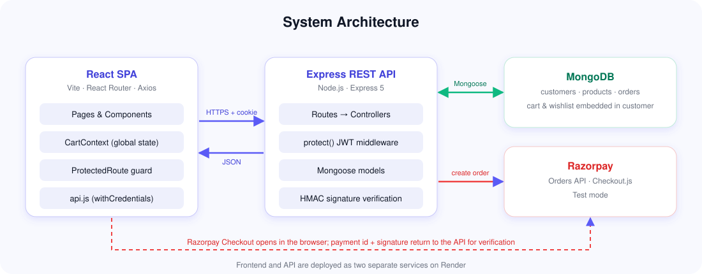
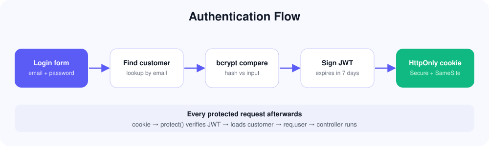
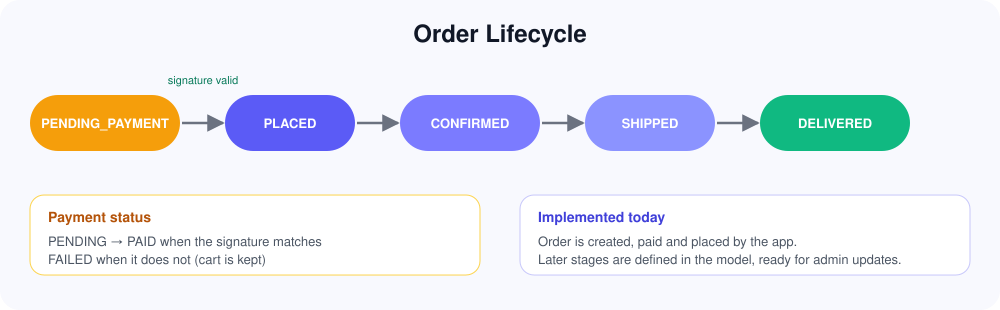
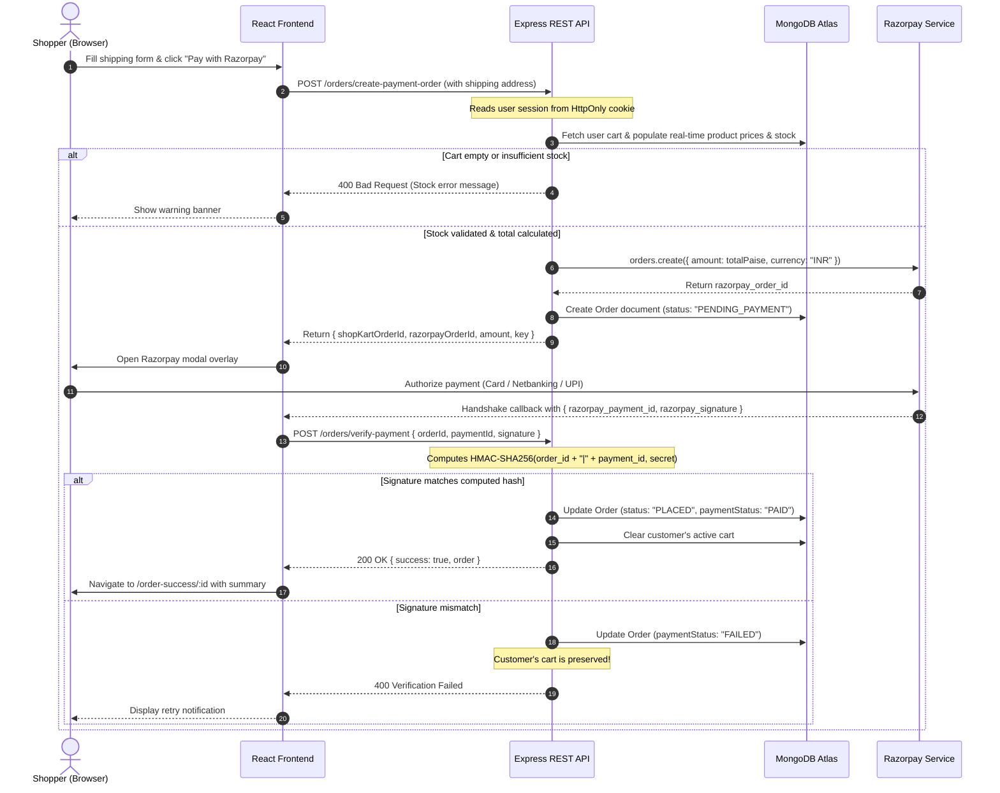
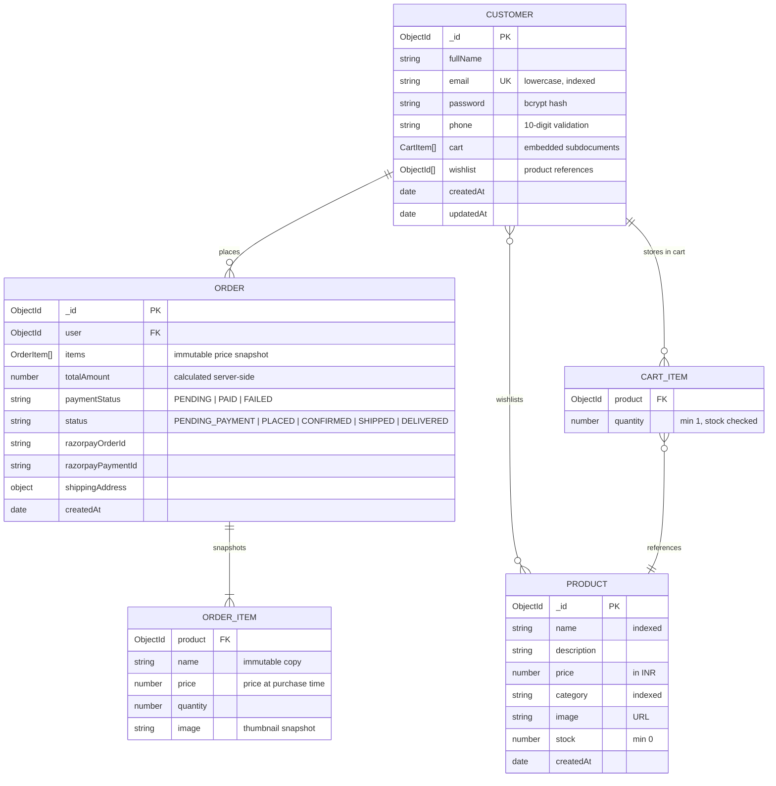

<div align="center">


<br/><br/>

[](https://shopkart-web-kgxy.onrender.com/)
[](https://shopkart-api-zs5k.onrender.com)
[](LICENSE)

<br/>


</div>

---

## Table of Contents

- [Overview](#overview)
- [Live Deployments](#live-deployments)
- [Codebase & Architecture at a Glance](#codebase--architecture-at-a-glance)
- [Feature Highlights](#feature-highlights)
- [Technology Stack](#technology-stack)
- [System Architecture](#system-architecture)
- [Authentication & Session Flow](#authentication--session-flow)
- [Checkout & Payment Verification Lifecycle](#checkout--payment-verification-lifecycle)
- [Database Schema & Data Model](#database-schema--data-model)
- [REST API Reference](#rest-api-reference)
- [Directory Structure](#directory-structure)
- [Local Development Guide](#local-development-guide)
- [Environment Configuration](#environment-configuration)
- [Production Deployment](#production-deployment)
- [Security & Architectural Decisions](#security--architectural-decisions)
- [Author & Maintenance](#author--maintenance)

---

## Overview

**ShopKart** is a production-style, full-stack e-commerce platform built on the MERN stack (MongoDB, Express, React, Node.js). It handles the complete lifecycle of modern online retail: customer identity, catalogue search and filtering, server-synchronized cart and wishlist management, tamper-proof server-side order calculation, and end-to-end Razorpay payment processing.

Most sample e-commerce projects rely on client-side state, unverified totals, or plain tokens kept in `localStorage`. ShopKart was engineered with a security-first and server-authoritative mindset:

- **Server-Authoritative Pricing**: The client never tells the server what an order costs. Totals and line items are re-queried and calculated directly from MongoDB models during checkout.
- **Tamper-Proof Cryptographic Verification**: Payments are verified using HMAC-SHA256 signatures generated with the Razorpay key secret on the server before an order is transitioned to `PAID`.
- **Zero Token Leakage via HttpOnly Cookies**: JWTs are transmitted strictly inside `HttpOnly`, `SameSite=None`, `Secure` cookies, eliminating exposure to JavaScript and XSS vectors.
- **Stock Guard Rails**: Real-time stock availability is enforced both when adding items to the cart and at the instant of order generation.
- **Persistent Server Cart**: Cart and wishlist data are saved directly to the customer's record in MongoDB, allowing seamless shopping across devices and page reloads.

---

## Live Deployments

The application is deployed across independent Render services with automated CI/CD builds connected to GitHub:

| Service | Environment | Live URL | Description |
|---|:---:|---|---|
| **Storefront (Frontend)** | Production | [https://shopkart-web-kgxy.onrender.com/](https://shopkart-web-kgxy.onrender.com/) | React SPA built with Vite, served over HTTPS with client-side routing rewrites. |
| **REST API (Backend)** | Production | [https://shopkart-api-zs5k.onrender.com](https://shopkart-api-zs5k.onrender.com) | Node.js + Express 5 web service with MongoDB Atlas connectivity and Razorpay integration. |

> **Note on Cold Starts**: Render free-tier services spin down after periods of inactivity. If the initial page load takes ~30–50 seconds, the backend container is completing its automated spin-up.
>
> **Testing Payments**: Payments run in **Razorpay Test Mode**. Real money is never charged. You can use standard test credentials (e.g. Card: `4111 1111 1111`, any future expiry date and CVV, or any UPI ID like `success@razorpay`).

---

## Codebase & Architecture at a Glance

<div align="center">
  
</div>

The project maintains a clean separation between presentation and business logic across 24 REST endpoints:
- **Pages & Components**: Modular React architecture utilizing dedicated layout containers, custom hooks, and context providers.
- **Controllers & Middlewares**: Standardized Express request handlers with centralized error propagation and granular authentication guards.
- **CSS Design System**: Zero heavy CSS framework overhead; engineered with custom CSS variables, responsive typography, and glassmorphic surface tokens.

---

## Feature Highlights

<div align="center">
  
</div>

### 1. Customer Authentication & Identity
- Registration with validation for full name, email format, 10-digit phone number, and minimum 6-character password.
- Passwords hashed using `bcrypt` (10 salt rounds) inside a Mongoose pre-save hook.
- Stateless authentication with JSON Web Tokens (JWT) issued into an `HttpOnly` cookie.
- Automatic session hydration on application boot via `GET /customers/me`.
- Client-side navigation guards via `<ProtectedRoute />` preventing unauthorized access to checkout, orders, or cart.
- Secure customer profile viewing and in-app password changes.

### 2. Product Discovery & Catalogue
- Dynamic product listing displaying title, price, category badge, thumbnail, and remaining stock.
- Debounced live search querying product names and descriptions without spamming backend routes.
- Category filtering aggregated dynamically from database inventory rather than hardcoded lists.
- Multi-mode sorting (price low-to-high, price high-to-low, newest first).
- URL-synchronized query parameters (`?search=...&category=...&sort=...`) ensuring search results can be bookmarked or shared.
- Dedicated product detail view with inventory indicators and one-click add to cart/wishlist.

### 3. Server-Synchronized Cart & Wishlist
- Cart and wishlist saved directly to MongoDB, preserving shopper intent across browser sessions and devices.
- Immediate stock validation preventing shoppers from requesting more units than inventory allows.
- Quantity increments, decrements, item deletion, and full cart clearing.
- Real-time cart count badge synced across the entire site through a shared React `CartContext`.
- One-click wishlist toggle with immediate visual state feedback.

### 4. Checkout, Orders & Payment Processing
- Structured checkout form capturing delivery address (recipient, phone, street, city, state, 6-digit postal code).
- Server-side order compilation: the server looks up the user's active cart, calculates total in Indian Rupees (INR) and paise, locks the amount, and communicates with Razorpay.
- Inline Razorpay modal execution with support for cards, netbanking, and UPI simulations.
- Cryptographic verification of payment signatures on the backend before any database mutation.
- Resilient cart handling: cart is cleared only upon verified payment confirmation; abandoned or failed transactions preserve cart items intact.
- Comprehensive order history interface showing historical price/image snapshots, order date, delivery address, and status badges.

---

## Technology Stack

<div align="center">
  
</div>

### Frontend Tier
| Technology | Version | Purpose & Implementation Details |
|---|:---:|---|
| **React** | `18.2.0` | Declarative UI composition with functional components, custom hooks, and React Context. |
| **Vite** | `5.0.8` | Lightning-fast ESM dev server, optimized rollup bundling, and production build minification. |
| **React Router** | `6.20.0` | Client-side routing, protected route wrappers, dynamic parameter matching, and URL query state. |
| **Axios** | `1.6.2` | HTTP client configured with `withCredentials: true` to seamlessly pass HttpOnly cookies cross-origin. |
| **Plus Jakarta Sans** | Web Font | Clean, modern typography designed for high readability in e-commerce interfaces. |
| **Vanilla CSS Tokens** | Custom | Structured CSS variable architecture (`--primary`, `--surface`, `--radius`, `--shadow`) with zero build bloat. |

### Backend Tier
| Technology | Version | Purpose & Implementation Details |
|---|:---:|---|
| **Node.js** | `20.x` | High-performance asynchronous JavaScript runtime environment. |
| **Express** | `5.1.0` | Minimalist web framework handling routing, JSON body parsing, and middleware chaining. |
| **MongoDB Atlas** | Cloud v7 | Managed multi-cloud document database providing resilient replication and JSON document storage. |
| **Mongoose** | `9.0.0` | Strict schema definition, pre-save cryptographic hooks, reference population, and validation. |
| **jsonwebtoken** | `9.0.2` | Cryptographic JWT signing with customizable expiration (`7d`) for session integrity. |
| **bcryptjs** | `3.0.2` | One-way salted password hashing protecting customer credentials. |
| **cookie-parser** | `1.4.7` | Express middleware parsing incoming request cookie headers into structured objects. |
| **cors** | `2.8.5` | Cross-Origin Resource Sharing configured with explicit origin whitelisting and credentials support. |

### Payment Gateway & Cloud Infrastructure
| Service | Role | Implementation |
|---|:---:|---|
| **Razorpay SDK** | Payment Processor | Server SDK creates orders and handles SHA-256 HMAC signature verification. |
| **Render Web Service** | Backend API Host | Automatic GitHub deployments, reverse proxy support with `trust proxy`, and environment secret management. |
| **Render Static Site** | Frontend Host | Global CDN distribution, automated Vite build execution, and SPA fallback rewrites (`/* -> /index.html`). |

---

## System Architecture

<div align="center">
  
</div>

ShopKart follows a decoupled 3-tier client-server architecture:

1. **Client Tier (Browser)**:
   - React SPA downloaded as static HTML/JS/CSS from the Render Static Site CDN.
   - Manages local UI states (navigation, filter inputs, cart context, modal visibility).
   - Communicates with the backend exclusively through JSON over HTTPS using Axios.
   - Never accesses MongoDB connection strings or Razorpay secrets.

2. **Application Tier (Express API on Render)**:
   - Configured with `app.set('trust proxy', 1)` to accurately interpret TLS headers from Render's reverse proxy.
   - CORS middleware configured to accept requests only from the production frontend origin while allowing cookie credentials.
   - Route-level middleware (`protect`) intercepts private endpoints, extracts and verifies the JWT, and attaches the active customer to `req.user`.
   - Controllers handle business logic: inventory validation, price calculation, Razorpay order generation, and signature verification.

3. **Data Tier (MongoDB Atlas & Razorpay Gateway)**:
   - MongoDB Atlas holds the persistent store for Customers, Products, and Orders.
   - Razorpay payment servers communicate with both the client modal (for payment collection) and the backend (for initial order registration and cryptographic signature validation).

---

## Authentication & Session Flow

<div align="center">
  
</div>

### Why HttpOnly Cookies Instead of `localStorage`?
Storing authorization tokens in `localStorage` or `sessionStorage` exposes tokens to any malicious third-party script running on the page via Cross-Site Scripting (XSS). 

ShopKart stores JWT tokens inside an `HttpOnly` cookie:
- **Inaccessible to Client JS**: `document.cookie` cannot read or modify the token.
- **Automatic Browser Delivery**: The browser automatically appends the cookie to all outgoing Axios requests targeting the API.
- **Cross-Site Configuration**: In production, cookies are flagged with `SameSite=None` and `Secure=true`, enabling cross-subdomain authentication between `shopkart-web-kgxy.onrender.com` and `shopkart-api-zs5k.onrender.com`.

### Session Verification Middleware (`protect`)
```javascript
// backend/middlewares/auth.middleware.js
export const protect = async (req, res, next) => {
  let token = req.cookies?.token;

  if (!token) {
    return res.status(401).json({ success: false, message: 'Not authorized, no token provided' });
  }

  try {
    const decoded = jwt.verify(token, process.env.JWT_SECRET);
    req.user = await Customer.findById(decoded.id).select('-password');
    if (!req.user) {
      return res.status(401).json({ success: false, message: 'User no longer exists' });
    }
    next();
  } catch (error) {
    return res.status(401).json({ success: false, message: 'Token invalid or expired' });
  }
};
```

---

## Checkout & Payment Verification Lifecycle

<div align="center">
  
</div>

### End-to-End Sequence Diagram



### Cryptographic Signature Verification
```javascript
// backend/controllers/order.controller.js
const body = razorpayOrderId + '|' + razorpayPaymentId;
const expectedSignature = crypto
  .createHmac('sha256', process.env.RAZORPAY_KEY_SECRET)
  .update(body.toString())
  .digest('hex');

if (expectedSignature === razorpaySignature) {
  order.paymentStatus = 'PAID';
  order.status = 'PLACED';
  order.razorpayPaymentId = razorpayPaymentId;
  await order.save();

  // Clear customer cart only after confirmed payment
  req.user.cart = [];
  await req.user.save();
}
```

---

## Database Schema & Data Model



### Key Schema Design Decisions
1. **Embedded Subdocuments for Carts**: Storing the customer's cart directly inside the `Customer` document allows reading the full shopper context in a single database roundtrip without expensive multi-collection joins.
2. **Historical Order Snapshots**: In `Order.items`, the product name, price, and thumbnail image are cloned into the order document at the moment of checkout. If an administrator later changes a product's price or description, past orders remain legally and historically accurate.

---

## REST API Reference

Base Production URL: `https://shopkart-api-zs5k.onrender.com`

*All routes marked with 🔒 require an active session (`token` HttpOnly cookie).*

### 1. Customer Authentication (`/customers`)

| Method | Endpoint | Auth | Description | Payload / Query |
|---|---|:---:|---|---|
| `POST` | `/customers/register` | Public | Create new account & automatically issue auth cookie | `{ fullName, email, password, phone }` |
| `POST` | `/customers/login` | Public | Authenticate user & issue JWT cookie | `{ email, password }` |
| `GET` | `/customers/me` | 🔒 | Get profile & active cart count | *None* |
| `POST` | `/customers/logout` | 🔒 | Expire auth cookie | *None* |
| `PATCH` | `/customers/change-password` | 🔒 | Update account password | `{ currentPassword, newPassword }` |

### 2. Catalogue & Products (`/products`)

| Method | Endpoint | Auth | Description | Payload / Query |
|---|---|:---:|---|---|
| `GET` | `/products` | Public | List items with search, filter & sort | `?search=shoes&category=Electronics&sort=price_asc` |
| `GET` | `/products/categories` | Public | Distinct list of available categories | *None* |
| `GET` | `/products/:id` | Public | Detailed view of a single product | Param: `id` |
| `POST` | `/products` | Public | Create a product listing | `{ name, description, price, category, image, stock }` |

### 3. Cart Management (`/cart`)

| Method | Endpoint | Auth | Description | Payload / Query |
|---|---|:---:|---|---|
| `GET` | `/cart` | 🔒 | Retrieve user cart with populated product data | *None* |
| `POST` | `/cart/:productId` | 🔒 | Add 1 unit of product to cart | Param: `productId` |
| `PATCH` | `/cart/:productId` | 🔒 | Update item quantity (stock validated) | `{ "quantity": 3 }` |
| `DELETE` | `/cart/:productId` | 🔒 | Remove item from cart | Param: `productId` |
| `DELETE` | `/cart/clear` | 🔒 | Remove all items from cart | *None* |

### 4. Wishlist (`/wishlist`)

| Method | Endpoint | Auth | Description | Payload / Query |
|---|---|:---:|---|---|
| `GET` | `/wishlist` | 🔒 | Get user's saved items with product details | *None* |
| `GET` | `/wishlist/count` | 🔒 | Get total wishlisted items count | *None* |
| `POST` | `/wishlist/:productId` | 🔒 | Add product to wishlist | Param: `productId` |
| `PATCH` | `/wishlist/:productId/toggle`| 🔒 | Toggle product in/out of wishlist | Param: `productId` |
| `DELETE` | `/wishlist/:productId` | 🔒 | Remove product from wishlist | Param: `productId` |

### 5. Orders & Payments (`/orders`)

| Method | Endpoint | Auth | Description | Payload / Query |
|---|---|:---:|---|---|
| `POST` | `/orders/create-payment-order` | 🔒 | Validate cart & create Razorpay order | Shipping address object (see below) |
| `POST` | `/orders/verify-payment` | 🔒 | Verify HMAC signature, clear cart, place order | `{ razorpayOrderId, razorpayPaymentId, razorpaySignature }` |
| `GET` | `/orders` | 🔒 | List past orders for logged in user (descending) | *None* |
| `GET` | `/orders/:id` | 🔒 | View details of specific order (owner guarded) | Param: `id` |

<details>
<summary><b>Example Request & Response: Creating a Payment Order</b></summary>

**Request:**
```http
POST /orders/create-payment-order HTTP/1.1
Host: shopkart-api-zs5k.onrender.com
Content-Type: application/json
Cookie: token=eyJhbGciOiJIUzI1NiIsInR5cCI6IkpXVCJ9...

{
  "shippingAddress": {
    "fullName": "Aarav Sharma",
    "phone": "9876543210",
    "addressLine1": "Flat 402, Green Glen Layout, Bellandur",
    "city": "Bengaluru",
    "state": "Karnataka",
    "pincode": "560103"
  }
}
```

**Response (200 OK):**
```json
{
  "success": true,
  "shopKartOrderId": "670da15e9821a4f5c9e2b012",
  "razorpayOrderId": "order_P3b9kKq8LmQ1Rs",
  "amount": 499900,
  "currency": "INR",
  "key": "rzp_test_YourPublicKeyHere"
}
```
*Note: `amount` is expressed in the smallest currency unit (paise for INR, i.e., ₹4,999.00).*
</details>

---

## Directory Structure

```text
Shopkart Final/
├── backend/
│   ├── config/
│   │   └── razorpay.js              # Initialized Razorpay client instance
│   ├── controllers/
│   │   ├── customer.controller.js   # Registration, login, profile, password changes
│   │   ├── product.controller.js    # Product queries, search, category aggregation
│   │   ├── cart.controller.js       # Cart queries, stock validation, mutations
│   │   ├── wishlist.controller.js   # Wishlist toggle and counting handlers
│   │   └── order.controller.js      # Razorpay order generation and HMAC verification
│   ├── middlewares/
│   │   └── auth.middleware.js       # protect() middleware verifying JWT cookies
│   ├── models/
│   │   ├── customer.model.js        # Customer schema, bcrypt pre-save, embedded cart
│   │   ├── product.model.js         # Product schema with price and stock limits
│   │   └── order.model.js           # Order schema with address and line-item snapshots
│   ├── routes/
│   │   ├── customer.routes.js       # Customer endpoints
│   │   ├── product.routes.js        # Product endpoints
│   │   ├── cart.routes.js           # Cart endpoints
│   │   ├── wishlist.routes.js       # Wishlist endpoints
│   │   └── order.routes.js          # Order endpoints
│   ├── utils/
│   │   └── generateToken.js         # JWT signing & cookie configuration utility
│   ├── .env.example                 # Template for environment variables
│   ├── index.js                     # Express app setup, DB connection, CORS, listen
│   └── package.json
│
├── frontend/
│   ├── src/
│   │   ├── components/
│   │   │   ├── Navbar.jsx           # Global navigation with live cart/wishlist counters
│   │   │   ├── ProductCard.jsx      # Product card with price, stock, and quick actions
│   │   │   ├── CartItem.jsx         # Cart row with quantity controls
│   │   │   ├── WishlistCard.jsx     # Saved product display card
│   │   │   └── SearchBar.jsx        # Debounced search input
│   │   ├── context/
│   │   │   └── CartContext.jsx      # Shared cart state and optimistic count updates
│   │   ├── pages/
│   │   │   ├── Home.jsx             # Hero landing page and catalogue preview
│   │   │   ├── Products.jsx         # Searchable, filterable catalogue grid
│   │   │   ├── ProductDetails.jsx   # Detailed item information & buy actions
│   │   │   ├── Wishlist.jsx         # Customer's saved wishlist view
│   │   │   ├── Cart.jsx             # Order summary and line-item management
│   │   │   ├── Checkout.jsx         # Shipping address form and Razorpay trigger
│   │   │   ├── OrderSuccess.jsx     # Post-payment confirmation and receipt
│   │   │   ├── Orders.jsx           # Historical orders with item snapshots
│   │   │   ├── Login.jsx            # Customer login form
│   │   │   └── Register.jsx         # Account creation form
│   │   ├── services/
│   │   │   └── api.js               # Centralized Axios client instance withCredentials
│   │   ├── App.jsx                  # React Router hierarchy and ProtectedRoute
│   │   ├── main.jsx                 # React root mount point
│   │   └── index.css                # Global CSS design system and tokens
│   ├── index.html                   # HTML5 shell with Google Font links
│   ├── vite.config.js               # Vite build configuration
│   └── package.json
│
├── docs/
│   └── assets/                      # Visual diagrams and graphics
│       ├── banner.svg               # Repository banner
│       ├── architecture.svg         # 3-Tier system architecture diagram
│       ├── auth-flow.svg            # Authentication sequence graphic
│       ├── codebase.svg             # Codebase metrics & endpoint distribution
│       ├── features.svg             # 6-Box feature capabilities matrix
│       ├── order-lifecycle.svg      # Order state machine & verification flow
│       └── tech-stack.svg           # Tech stack breakdown visual
│
└── README.md
```

---

## Local Development Guide

### Prerequisites
- **Node.js**: v18.0.0 or higher
- **npm**: v9.0.0 or higher
- **MongoDB**: Local MongoDB instance (`mongodb://localhost:27017/shopkart`) or a free MongoDB Atlas connection string.
- **Razorpay Account**: Free Razorpay account in Test Mode to generate API Key ID & Key Secret.

### 1. Clone Repository
```bash
git clone https://github.com/<your-username>/Shopkart-Final.git
cd "Shopkart Final"
```

### 2. Configure & Run Backend API
```bash
cd backend
npm install

# Create environment configuration
cp .env.example .env
```

Open `backend/.env` and supply your variables:
```env
PORT=5000
NODE_ENV=development
MONGO_URI=mongodb://localhost:27017/shopkart
JWT_SECRET=your_super_secret_jwt_key_here
JWT_EXPIRES_IN=7d
CLIENT_URL=http://localhost:5173
RAZORPAY_KEY_ID=rzp_test_YourTestKeyId
RAZORPAY_KEY_SECRET=YourTestKeySecret
```

Start the backend in development mode (with nodemon):
```bash
npm run dev
# Server listening on http://localhost:5000
# MongoDB connected successfully
```

### 3. Configure & Run Frontend Storefront
Open a second terminal window:
```bash
cd frontend
npm install
npm run dev
# Vite server running at http://localhost:5173
```

By default, Vite proxies requests or defaults to `http://localhost:5000` if `VITE_API_URL` is omitted.

---

## Environment Configuration

### Backend (`backend/.env`)

| Variable | Required | Default | Description |
|---|:---:|:---:|---|
| `PORT` | Optional | `5000` | Port on which Express server accepts requests. |
| `NODE_ENV` | Yes | `development` | Environment mode (`development` or `production`). In production, triggers `secure: true` on cookies. |
| `MONGO_URI` | Yes | — | MongoDB Atlas or local MongoDB connection URI string. |
| `JWT_SECRET` | Yes | — | Secret string used by `jsonwebtoken` to sign and verify cookies. |
| `JWT_EXPIRES_IN` | Optional | `7d` | Token expiration timeframe (e.g., `7d`, `24h`). |
| `CLIENT_URL` | Yes | `http://localhost:5173` | Allowed CORS origin. Must match frontend URL exactly without trailing slash. |
| `RAZORPAY_KEY_ID` | Yes | — | Razorpay public Key ID (`rzp_test_...` or `rzp_live_...`). |
| `RAZORPAY_KEY_SECRET` | Yes | — | Razorpay private Secret Key (never exposed to client). |

### Frontend (`frontend/.env` or Render Environment)

| Variable | Required | Default | Description |
|---|:---:|:---:|---|
| `VITE_API_URL` | Production | `http://localhost:5000` | Base URL of deployed Express API (e.g. `https://shopkart-api-zs5k.onrender.com`). |

---

## Production Deployment

### 1. Backend Web Service (Render)
1. Create a **New Web Service** connected to your repository.
2. Configure settings:
   - **Root Directory**: `backend`
   - **Runtime**: `Node`
   - **Build Command**: `npm install`
   - **Start Command**: `npm start`
3. Add Environment Variables:
   - `NODE_ENV`: `production`
   - `MONGO_URI`: `<Your MongoDB Atlas connection URI>`
   - `JWT_SECRET`: `<Secure random string>`
   - `CLIENT_URL`: `https://shopkart-web-kgxy.onrender.com`
   - `RAZORPAY_KEY_ID`: `<Your Razorpay Key ID>`
   - `RAZORPAY_KEY_SECRET`: `<Your Razorpay Key Secret>`
4. In `backend/index.js`, ensure reverse proxy trust is active:
   ```javascript
   app.set('trust proxy', 1);
   ```

### 2. Frontend Static Site (Render)
1. Create a **New Static Site** connected to your repository.
2. Configure settings:
   - **Root Directory**: `frontend`
   - **Build Command**: `npm install && npm run build`
   - **Publish Directory**: `dist`
3. Add Environment Variable:
   - `VITE_API_URL`: `https://shopkart-api-zs5k.onrender.com`
4. Add a **Redirect / Rewrite Rule**:
   - **Source**: `/*`
   - **Destination**: `/index.html`
   - **Action**: `Rewrite`
   *(This ensures client-side routes like `/products`, `/cart`, `/checkout` do not return 404s on browser refresh).*

---

## Security & Architectural Decisions

| Threat / Concern | Architectural Mitigation | Code Implementation |
|---|---|---|
| **Cross-Site Scripting (XSS) Token Theft** | Storing JWTs in `HttpOnly` cookies instead of browser storage. | Set with `httpOnly: true`; client scripts cannot read the session cookie. |
| **Cross-Site Request Forgery (CSRF)** | Strict CORS origin verification and SameSite constraints. | `cors({ origin: process.env.CLIENT_URL, credentials: true })` + `SameSite=None, Secure` in production. |
| **Price Tampering in Browser** | Zero trust in client-submitted prices or order totals. | Total is calculated on the server by loading matching product documents from MongoDB. |
| **Payment Spoofing & Fake Confirmations** | Mandatory server-side cryptographic signature check. | Razorpay HMAC-SHA256 signature verification executed before order is marked `PAID`. |
| **Stale Cart Overwrites on Failed Payments** | Cart state persistence decoupled from payment attempts. | Customer cart is only cleared upon successful signature verification; abandoned payments retain items. |
| **Stock Overselling & Race Conditions** | Multi-phase inventory availability checks. | Stock verified both when adding to cart and at the instant `/orders/create-payment-order` is invoked. |
| **Horizontal Privilege Escalation** | Route-level ownership validation. | In `/orders/:id`, order `user` ID must strictly match `req.user._id`, returning 403 Forbidden otherwise. |
| **Database Injection / Query Tampering** | Strict schema casting via Mongoose schemas. | Schema validation enforces types, required constraints, and ObjectId formats. |

---

## Author & Maintenance

Engineered by **Vansh Jagetia**.

Live Storefront: **[https://shopkart-web-kgxy.onrender.com/](https://shopkart-web-kgxy.onrender.com/)**  
Live Backend API: **[https://shopkart-api-zs5k.onrender.com](https://shopkart-api-zs5k.onrender.com)**
